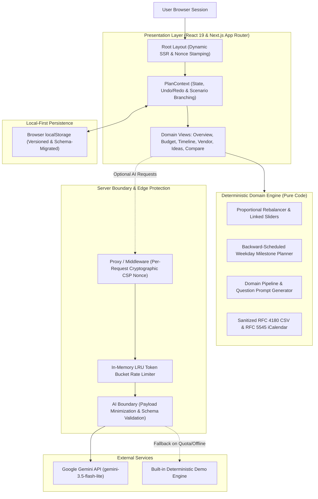

# Occasio Architecture & System Design

Occasio is an AI-assisted event planning workstation engineered with a strict **local-first, privacy-by-design** architecture. It pairs deterministic event logistics algorithms (written in pure TypeScript with zero AI dependencies) with Google Gemini (`gemini-3.5-flash-lite`) for creative aesthetic curation.

---

## 1. High-Level System Architecture



---

## 2. Architectural Principles

### A. Local-First & Privacy Boundary
- **Zero Cloud Storage**: All event plans, quotes, financial ledgers, and milestone dates reside exclusively inside the browser's `localStorage`.
- **Payload Minimization**: When interacting with the AI endpoint (`/api/generate` or `/api/copilot`), personal names, phone numbers, email addresses, and event titles are **never transmitted**. Only 9 sanitized logistic fields (`eventType`, `guestCount`, `budgetTier`, `leadTimeDays`, `city`, `style`, `dietaryRequirements`, `culturalNeeds`, `priorities`) are sent.
- **Single Source of Truth**: The transmitted fields are codified in `AI_PAYLOAD_EXACT_FIELDS` in [`src/domain/schemas/plan.ts`](file:///c:/projects/occacio/src/domain/schemas/plan.ts) and verified by unit tests in [`tests/unit/ai/payload_privacy.test.ts`](file:///c:/projects/occacio/tests/unit/ai/payload_privacy.test.ts).

### B. Deterministic Core Logic vs. Creative AI
- **Math is Never Delegated to AI**:
  - Budget category allocation and slider rebalancing are executed via pure integer arithmetic in [`src/domain/budget/allocation.ts`](file:///c:/projects/occacio/src/domain/budget/allocation.ts).
  - Milestone scheduling is calculated backward from the event date and snapped to weekdays in [`src/domain/timeline/generate.ts`](file:///c:/projects/occacio/src/domain/timeline/generate.ts).
  - Vendor checklist stages and procedural questions are computed deterministically in [`src/domain/checklist/generate.ts`](file:///c:/projects/occacio/src/domain/checklist/generate.ts).
- **AI Scope**: Gemini generates creative atmosphere narratives, 5-color harmony palettes with precomputed WCAG contrast ratings, and bespoke culinary concepts.

### C. Security & Content Security Policy (CSP)
- **Strict Dynamic Nonce-Based Policy**:
  ```text
  default-src 'self';
  script-src 'self' 'nonce-{random}' 'strict-dynamic';
  style-src 'self' 'unsafe-inline';
  img-src 'self' data: blob: https://images.unsplash.com;
  font-src 'self';
  connect-src 'self';
  frame-ancestors 'none';
  object-src 'none';
  base-uri 'self';
  form-action 'self';
  ```
- **Zero `eval` (JIT-less Zod)**:
  Zod is explicitly configured with `z.config({ jitless: true })` across all domain schemas and client bundle entrypoints. This prevents runtime `Function("")` capability probes, guaranteeing zero `securitypolicyviolation` events in production.
- **Dynamic Per-Request Nonce Generation**:
  Server layout generates a fresh 16-byte base64 nonce per request, stamping all Next.js `<script>` tags on dynamic HTML responses (`Cache-Control: private, no-store`).

---

## 3. Directory Layout & Module Structure

```text
occacio/
├── src/
│   ├── app/                     # Next.js App Router (Layout, Page, API routes)
│   │   ├── api/
│   │   │   ├── copilot/         # Contextual conversational assistant endpoint
│   │   │   ├── generate/        # Aesthetic ideas generation endpoint
│   │   │   └── health/          # Operational health & AI status probe
│   │   ├── layout.tsx           # Dynamic SSR layout & CSP nonce propagator
│   │   └── page.tsx             # Main application orchestrator
│   ├── components/              # Modular UI components
│   │   ├── budget/              # Proportional budget sliders & breakdown
│   │   ├── checklist/           # Vendor procurement Kanban & notes
│   │   ├── compare/             # Scenario comparison side-by-side view
│   │   ├── copilot/             # AI Copilot interactive drawer
│   │   ├── export/              # CSV and iCalendar export dialog
│   │   ├── ideas/               # Color swatches, atmosphere & menu studio
│   │   ├── layout/              # Header, navigation, status pill popovers
│   │   ├── onboarding/          # Modular 4-step wizard & welcome screen
│   │   ├── overview/            # Modular dashboard, hero arch, deadlines, health
│   │   ├── timeline/            # Milestone timeline & Gantt calendar
│   │   └── ui/                  # Design system primitives (Button, Tooltip, Modals)
│   ├── domain/                  # Pure TypeScript domain logic (Zero UI dependencies)
│   │   ├── budget/              # Money formatting & allocation math
│   │   ├── checklist/           # Checklist generator
│   │   ├── export/              # CSV & ICS formatting
│   │   ├── schemas/             # Zod domain schemas (Plan, Budget, Timeline, etc.)
│   │   └── timeline/            # Milestone scheduling & date math
│   └── lib/                     # Infrastructure & utilities
│       ├── ai/                  # Gemini client, demo engine & prompt sanitizers
│       ├── context/             # PlanContext state management & history stack
│       ├── format/              # Money, date, and pluralization formatters
│       ├── rate-limit/          # Token-bucket rate limiter
│       └── storage/             # Versioned localStorage repository & migrations
├── tests/                       # Comprehensive test suites
│   ├── component/               # React Testing Library component integration tests
│   ├── e2e/                     # Playwright cross-browser & accessibility tests
│   └── unit/                    # Vitest unit tests for domain logic & storage
└── scripts/                     # Operational verification & size guardrails
```

---

## 4. State Management & Undo / Redo Architecture

State is managed locally through `PlanContext` (`src/lib/context/PlanContext.tsx`):
- **Immutable History Stack**: Plan state changes push immutable snapshots to `history: Plan[]`.
- **Bounded Navigation**: `canUndo` and `canRedo` flags dictate keyboard and UI operations (`Ctrl+Z`, `Ctrl+Y`).
- **Scenario Branching**: `duplicatePlanForScenario` deep-clones the active plan into an independent `scenarioPlan` instance for side-by-side comparison without altering the original baseline.
- **Autosave & Hydration**: Changes automatically persist to `localStorage` through `savePlan`.
